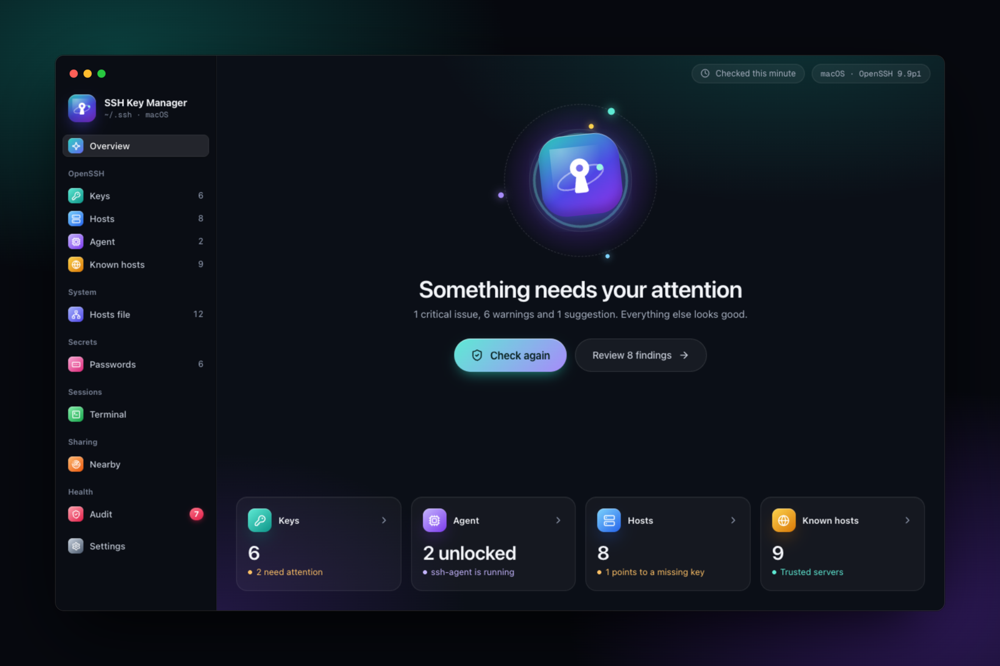
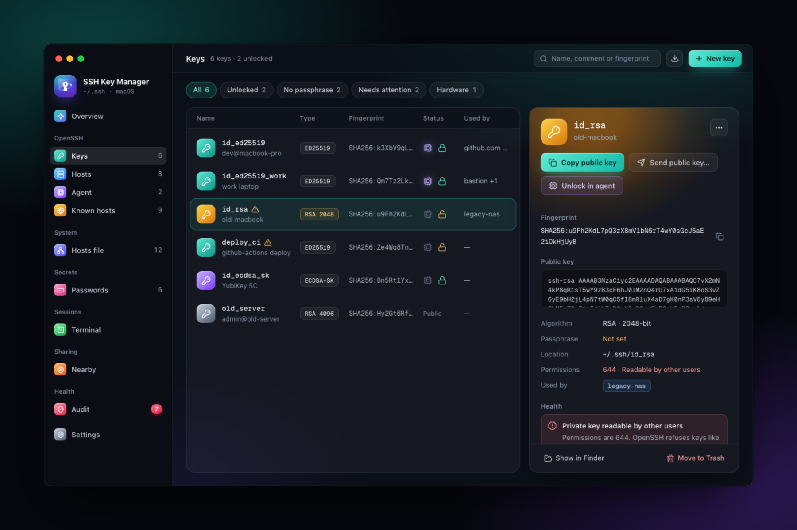
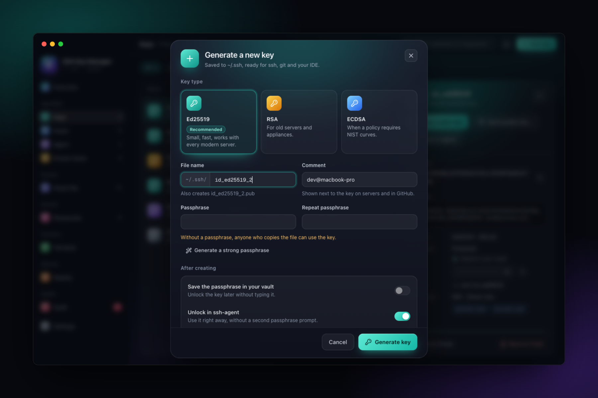
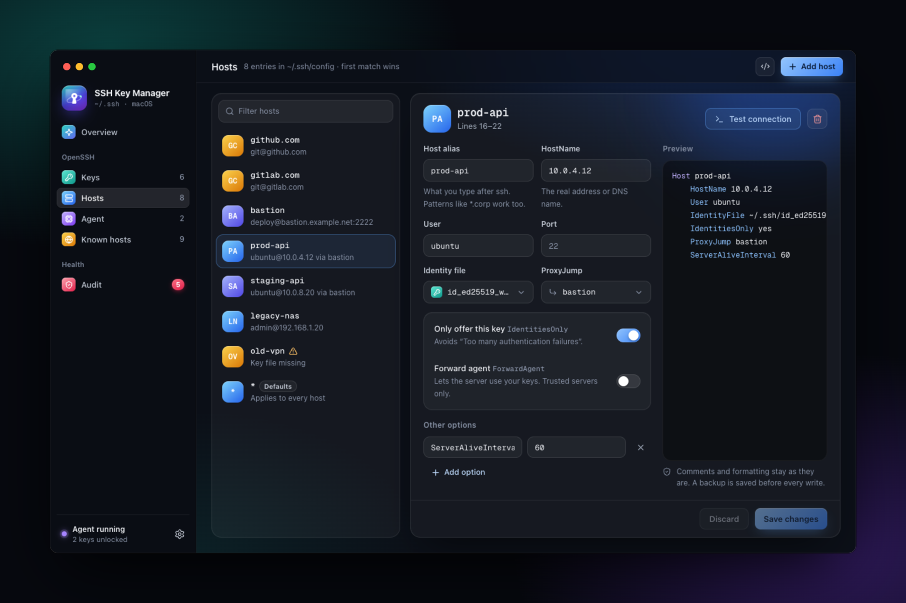
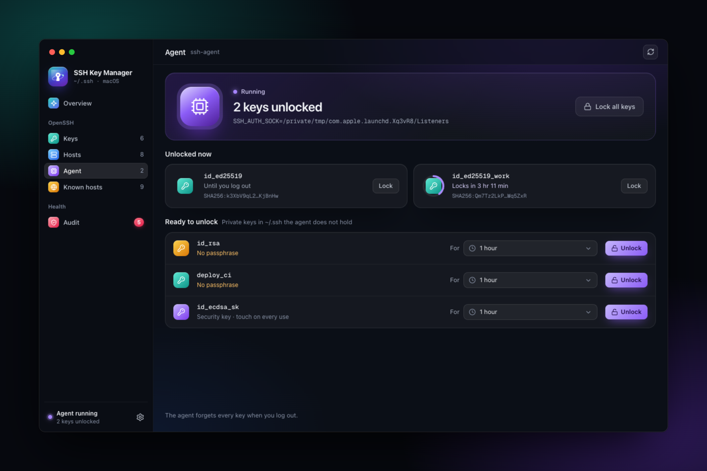
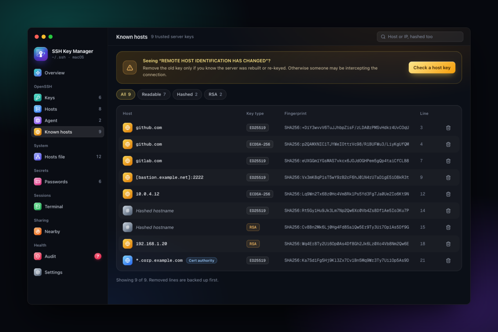

  

<h1 align="center">SSH Key Manager</h1>

  Your SSH keys, hosts and agent in one clear window. 
  For macOS, Windows and Linux · in English, Русский and Oʻzbekcha

  <a href="https://github.com/nuriddin2468/ssh-key-manager/releases/latest"><b>Download</b></a> ·
  <a href="https://github.com/nuriddin2468/ssh-key-manager/actions/workflows/build.yml">Latest builds</a> ·
  <a href="#what-it-does">Features</a> ·
  <a href="#privacy-and-safety">Privacy</a>

  
  
  

  

---

SSH Key Manager is a desktop app for the SSH setup you already have.

- It works directly on the standard OpenSSH files (`~/.ssh`, `~/.ssh/config`, `~/.ssh/known_hosts`) and the `ssh-agent` your system runs, so `ssh`, `git` and your IDE keep working exactly as before.
- There is no account, no cloud and no new place your keys live.
- One click checks your whole setup, and anything that needs fixing is explained in plain words.

## Download

| System                | File                          | Notes                                                     |
| --------------------- | ----------------------------- | --------------------------------------------------------- |
| **macOS** 12 or later | `.dmg`                        | One universal build for Apple Silicon and Intel           |
| **Windows** 10 or 11  | `.msi` or `.exe`              | Uses the OpenSSH client built into Windows                |
| **Linux**             | `.deb`, `.rpm` or `.AppImage` | Needs `openssh-client` (installed with the `.deb`/`.rpm`) |

**[Get the latest release →](https://github.com/nuriddin2468/ssh-key-manager/releases/latest)**

The browser extension for autofill is in the [Chrome Web Store](https://chromewebstore.google.com/detail/ssh-key-manager/lkmgdcanagjeajepncgokapkbihahddb) (Chrome, Edge, Brave and other Chromium browsers); turn it on in **Settings → Browser autofill**.

Want the newest version before a release? Every change to the `main` branch is built automatically.

1. Open the [latest builds](https://github.com/nuriddin2468/ssh-key-manager/actions/workflows/build.yml) and pick the top green run.
2. Download your system's file from **Artifacts**. You need to be signed in to GitHub, and the files are kept for 30 days.

Once installed, the app keeps itself up to date: it offers new versions as they are released, and checks every update's signature before installing it.

See also the [Code signing policy](#code-signing-policy).

### First launch

Builds are not code-signed yet (it's on the [roadmap](#roadmap)), so your system asks once whether you trust the app.

- **macOS.** Open the `.dmg` and drag the app to **Applications**. The first time, right-click it and choose **Open**, then **Open** again. If macOS still refuses, go to **System Settings → Privacy & Security** and click **Open Anyway**.
- **Windows.** If SmartScreen says "Windows protected your PC", click **More info → Run anyway**.
- **Linux.** Install the `.deb` or `.rpm` with your package manager. For the AppImage, run `chmod +x SSH*.AppImage` and start it.

## What it does

<table>
  <tr>
    <td width="50%">
<b>Keys</b>: everything about each key, with fixes for what's wrong
</td>
    <td width="50%">
<b>New key</b>: Ed25519, RSA or ECDSA in one dialog
</td>
  </tr>
  <tr>
    <td width="50%">
<b>Hosts</b>: edit <code>~/.ssh/config</code> with a form
</td>
    <td width="50%">
<b>Agent</b>: unlock keys for 1 hour, 8 hours or until logout
</td>
  </tr>
  <tr>
    <td width="50%">
<b>Audit</b>: what weakens your security, and how to fix it
</td>
    <td width="50%">
<b>Known hosts</b>: the servers you trust, and safe clean-up
</td>
  </tr>
</table>

Screenshots show sample data.

**Overview.** One button checks your keys, config and file permissions and tells you, in a sentence, how things stand.

**Keys**
- See every key in `~/.ssh` at a glance: its type, fingerprint, whether it has a passphrase, whether it is loaded in the agent, and which servers use it.
- Create a new key (Ed25519, RSA or ECDSA). The same dialog can unlock it in the agent and add a server entry for it.
- Copy a public key in one click, ready to paste into GitHub, GitLab or a server.
- Add, change or remove a passphrase. Import existing keys.
- Deleted keys go to the Trash, so you can get them back.

**Hosts.** Edit `~/.ssh/config` with a form instead of a text editor, so you can type `ssh prod` instead of the full address, user, port and key.
- Your comments and formatting are kept exactly as they were, and a backup is made before every change.
- Test a connection right from the app.
- Prefer text? Edit the raw file in the app.

**Agent.** See which keys are unlocked right now. Unlock a key for 1 hour, 8 hours or until you log out, and lock one or all with a click.

**Known hosts**
- Browse the servers you have trusted, including hashed entries.
- Seeing "REMOTE HOST IDENTIFICATION HAS CHANGED"? The app fetches the server's current key and compares it with the saved one, so you know whether it is safe to remove the old entry.

**Audit**
- Finds the things that weaken security or quietly break SSH:
  - old or short keys;
  - keys without a passphrase;
  - private keys other users can read;
  - config lines that point to missing files.
- Fixes file permissions in one click.

**Passwords**
- An encrypted vault for server passwords, key passphrases and website logins. It is a standard KeePass file on your computer (or in a folder you choose, such as Dropbox or iCloud Drive), so KeePassXC opens it too.
- One master password unlocks it, or Touch ID / Windows Hello. A recovery key, shown once when you create the vault, gets you back in if you forget the master password.
- Copy a password or 2FA code in one click: it stays out of clipboard history and is cleared after 30 seconds. A password generator and a strength meter are built in.
- It locks itself after a few idle minutes, when the computer sleeps and when the screen locks.
- Works with the rest of the app: a new key's passphrase can be generated and saved for you, keys unlock in the agent with their saved passphrase, a server's saved password and 2FA code are used to test the connection, and a guided step moves a server from a password to a key.
- Import from Bitwarden, 1Password, Chrome, Edge, Firefox, Apple Passwords or KeePassXC; export as a KeePass copy or CSV. The Audit points out weak, reused and old passwords.
- Browser autofill (optional): the SSH Key Manager extension for Chrome, Edge and Firefox ([Chrome Web Store](https://chromewebstore.google.com/detail/ssh-key-manager/lkmgdcanagjeajepncgokapkbihahddb)) fills a site's saved logins on that site only, and offers to save new ones. Each browser is connected once, with a code you compare in the app.

**Terminal**
- Connect to a server in the app: sessions open in tabs and keep running while you use other sections.
- Passwords, 2FA codes and key passphrases come from the vault. Anything missing is asked in a dialog, with an option to save it once you're signed in.
- A server you've never connected to shows its key fingerprint first, and you decide whether to trust it. A server whose key changed is stopped, with a way to compare the keys.

**Nearby**
- Pair with a colleague's computer, or another of your own, on the same network: both screens show a six-digit code, and you pair only if they match.
- Send a password, a host, a group of your hosts file or your public key. Nothing is saved until the other side accepts, and a hosts file group is written only after they review the change and give the administrator password.
- Computers talk to each other directly and encrypted. There is no server in between, and your computer is visible to others only for ten minutes after you ask.
- Set up a new computer of your own from one you have: it gets your vault over the network after you compare the codes and confirm with Touch ID or your master password, and sets its own master password.
- Keep your hosts and server keys in step across your computers with **Sync now**. Each computer keeps its own sign-in keys; changes that run a program, many deletions and conflicts wait for your choice.

**Feels native.** Menu bar and keyboard shortcuts on macOS (⌘1–9, ⌘N, ⌘T, ⌘,), and changes you make in a terminal show up instantly.

## Privacy and safety

- **Nothing leaves your computer.** The app sends none of your data anywhere. It goes online only to check GitHub for a new version of itself (you can turn this off in **Settings → Updates**) and when you ask it to reach a server: checking a host key, testing a connection or opening a terminal session. **Nearby** talks only to other computers running the app on your local network, directly and encrypted, and only while you use it, or, for your own computers, while your vault is unlocked (you can turn that off).
- **Your private keys stay private.** The interface only ever sees public keys and fingerprints. Passphrases are used once and never stored, unless you save them in your password vault.
- **Your passwords stay encrypted.** The vault is decrypted only in memory while it's unlocked, and the interface sees a password only when you choose to reveal it. There is no way in without the master password or the recovery key, so keep the recovery key somewhere safe.
- **Your files stay standard.** Everything is plain OpenSSH, and you can stop using the app at any time.
- **Mistakes can be undone.** Config files are backed up before every edit, and keys go to the Trash, not into oblivion.
- **Administrator rights only when you save the hosts file.** The app never keeps them: it shows you the diff, asks for your password once, and backs up the file first.

Details in [SECURITY.md](SECURITY.md); the privacy policy for the app and the browser extension is in [PRIVACY.md](PRIVACY.md).

## FAQ

**Does it replace `ssh-agent` or store my keys somewhere else?**
No. It works with the agent your system already runs and the keys already in `~/.ssh`.

**Where are the backups?**
Open **Settings → Files → Backups**. The app keeps the 20 most recent copies of each file.

**Can I use it with keys outside `~/.ssh`?**
Hosts can point to keys anywhere, and the app shows them. The key list itself covers `~/.ssh`.

**Something doesn't look right?**
[Open an issue](https://github.com/nuriddin2468/ssh-key-manager/issues/new) with your system and what you expected to see.

## Roadmap

- **Signed Windows builds**, so Windows names the publisher instead of "Unknown publisher" and SmartScreen stops warning as the app builds a reputation. Signing through SignPath Foundation is being set up.
- **Signed and notarized macOS builds**, so macOS opens the app without asking. This needs an Apple Developer account.

## Code signing policy

Free code signing provided by [SignPath.io](https://about.signpath.io), certificate by [SignPath Foundation](https://signpath.org).

Windows releases are built by GitHub Actions from this repository, and each release is signed only after a maintainer approves it.

- Committers and reviewers: [nuriddin2468](https://github.com/nuriddin2468)
- Approvers: [nuriddin2468](https://github.com/nuriddin2468)

Privacy policy: this program will not transfer any information to other networked systems unless specifically requested by the user or the person installing or operating it. The one exception is the update check, which downloads the release list from this repository's GitHub Releases at startup and every six hours; turn it off in **Settings → Updates**. See [Privacy and safety](#privacy-and-safety).

## Contributing

SSH Key Manager is open source. To build it yourself or help out, see [CONTRIBUTING.md](CONTRIBUTING.md).

## License

[GNU Affero General Public License v3.0](LICENSE) (`AGPL-3.0-only`).

Versions up to and including 0.4.0 were released under the MIT license, and those releases stay available under it.
